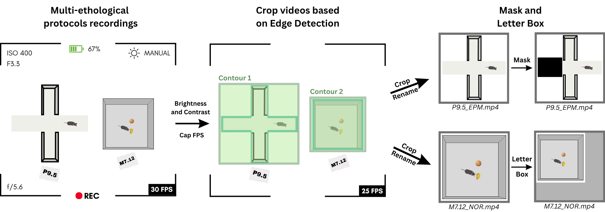

<p align="center">
  
</p>

<h1 align="center">Preprocess Recordings of Ethological Protocols (PREP).</h1>

GUI-based pipeline using FFMPEG allowing for the pre-process of standardised behavioural protocol recordings. 
It allows for easier video pre-processing and faster dataset preparation for machine learning algorithms. 

<div style="text-align: center;">
  
</div>

# Installation & Set-up

- Clone this repository

- [Install FFMPEG](https://ffmpeg.org/download.html) (adding it to PATH is not necessary)

- If you are on Windows, [Install WSL](https://learn.microsoft.com/en-us/windows/wsl/install)

- Go this repository directory ```cd PREP```

- Install the requirements in a new python *env*

```
pip install -r requirements.txt
```

- Run ```GUI.py```

- In home page (default) set FFMPEG.exe path (in FFMPEG directory ```bin\ffmpeg.exe```)

### System Requirements

- Python 3.10+
- FFMPEG
- Linux. Windows with WSL as it uses bash. No idea on Mac

# Features

### - **Cap video FPS**

    Input : <str> Directory containing video files
              (it must only contain the files that will be capped)
            <int> Number of FPS to cap the video
              (lower than the video's FPS)

    Ouput : <str> Directory where the files will be saved with the desired FPS in format .mp4

### - **Contrast and Brightness**

    Input : <str> Directory containing video files
              (it must only contain the files that will be contrasted)

    Process : Matplotlib fig with current frame from the video
                Brightness slider - 0 to 255
                Constrast slider - 0 to 255

    Ouput : <str> Directory where the files will be saved with the desired contrast and brightness

### - **Multi-crop video based on Edge Detection**

    Input : <str> Directory containing video files
              (it must only contain the files that will be cropped)

    Process : Matplotlib fig with current frame from the video
                Canny threshold min slider - 0 to 255
                Canny threshold max slider - 0 to 255
              Edge detection to find contours
                Click on contour to establish bounding box
              Manual bounding box mode

    Ouput : <str> Directory where the cropped files will be saved with the name given in the process

### - **Mask Video areas**

    Input : <str> Directory containing video files
              (it must only contain the files that will be masked)

    Process : Matplotlib fig with current frame from the video
                Drag a box to establish a rectagular zone to mask (/!\ only one per video)

    Ouput : <str> Directory where the files will be saved with the mask


### - **Letter Box video into a given size**

    Input : <str> Directory containing video files
              (it must only contain the files letter boxed)

    Ouput : <str> Directory where the files will be saved with the desired contrast and brightness$

# Click/Key bindings

    LEFT CLICK  - Select contours in "Crop" or create manual boxes in both "Crop" and "Mask"

    RIGHT CLICK - Deselect selected boxes in "Crop"

    LEFT ARROW  - Goes to previous frame in each video ("Constrast", "Crop" & "Mask")

    RIGHT ARROW - Goes to next frame in each video ("Constrast", "Crop" & "Mask")

    B           - Toggles manual mode in "Crop" to draw a manual bounding box

    ENTER       - Applies filters and moves to the next video ("Constrast", "Crop" & "Mask")

    ESCAPE      - Quits python visualisers ("Constrast", "Crop" & "Mask")

## AI disclosure

Qwen 3.5 9B using llama.cpp was used to improve syntax.

## Citation

Feel free to cite this repository!

## Authors

Pedro Ferreira (University of Lausanne)

---